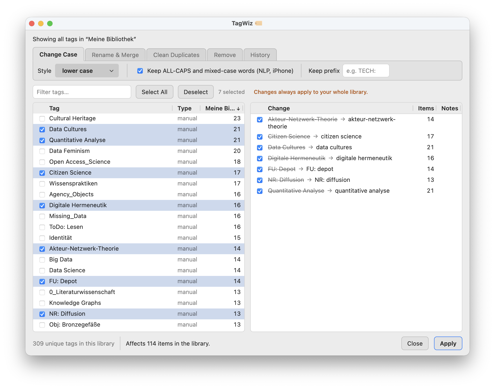

# TagWiz 🏷️

TagWiz is a tag editor for [Zotero](https://www.zotero.org/) that tames the sprawling tags in your library with a flick of its wand. 🧙‍♂️🔮

In other words: its a plugin for cleaning up tags in bulk: change their case, rename them or merge multiple tags into one, remove several at once, and find and merge duplicates.



## Table of contents

- [Installation](#installation)
- [Usage](#usage)
  - [Change Case](#change-case)
  - [Rename & Merge](#rename--merge)
  - [Remove](#remove)
  - [Duplicates](#duplicates)
  - [Undo & History](#undo--history)
- [Compatibility](#compatibility)
- [Development](#development)
- [License](#license)

## Installation

1. Download the latest `tag-wiz.xpi` from the [Releases page](https://github.com/tsmdt/zotero-tagwiz/releases/latest). If your browser tries to open the file, right-click the link and choose **Save Link As…**.
2. In Zotero, open **Tools → Plugins**, click the gear icon and choose **Install Plugin From File…**.
3. Select the downloaded `.xpi` file and restart Zotero if asked.

## Usage

Open TagWiz from the **Tools** menu, or right-click a collection and choose **TagWiz 🏷️**. The window lists the tags used in the selected collection (including on its items' notes, attachments and annotations), or all tags if a library is selected. Tick **Include subcollections** to count items in subcollections too.

> [!important]
> **Every change applies to the whole library**, including items outside the currently selected collection (as well as items in the trash). The preview says how many items are affected (items that only carry a merge target are not counted: they don't change) and how many of them are outside the collection.

Pick a tab, select tags (click a row to tick it, Shift + Click to tick every row up to the one clicked last; the filter box helps with long lists), check the preview, untick anything you do not want, and press **Apply**.

### Change Case

Choose a style: lower case, UPPER CASE, Title Case, Sentence case, camelCase, PascalCase, snake_case or kebab-case. For example, `machine learning` becomes `Machine Learning` in Title Case and `machine_learning` in snake_case. Two options refine the result:

- **Keep ALL-CAPS and mixed-case words**: words like `NLP` or `iPhone` stay as they are in every style except UPPER CASE. `NLP methods` becomes `NLP Methods` in Title Case instead of `Nlp Methods`, `iPhone apps` becomes `iPhone Apps` instead of `Iphone Apps`, and `LLM Framework Studies` becomes `LLMframeworkStudies` in camelCase.
- **Keep prefix**: type a prefix such as `TECH: `, `00_` or `Aa-`. In tags that start with exactly this text (case-sensitive, spaces count), the prefix stays as typed and only the rest changes: `TECH: 2026 deep learning` becomes `TECH: 2026DeepLearning` in camelCase. Leave it empty to convert whole tags.

snake_case, kebab-case, camelCase and PascalCase split words at spaces, "-" and "\_" only, so other characters are kept: `C++ programming` becomes `c++_programming`, not `c_programming`. A leading or trailing "-" or "\_" stays too, so workflow tags keep sorting first: `_to read` becomes `_to_read` in snake_case and `_toRead` in camelCase.

If two tags end up with the same name, the preview marks them as a merge.

### Rename & Merge

Select one tag to rename it, or two or more to merge them, then type or pick the new name. The name can be one of the selected tags, another existing tag, or a new name. Renaming a tag to the name of an existing tag merges the two.

### Remove

Select tags and apply to delete them from every item. Tags that have a color lose it, and the preview says so. Tags selected on another tab are not carried over to this one, and the confirmation lists the tags it removes.

### Duplicates

Choose how strict the match is:

- **Same name, different type**: the same text used as both a manual and an automatic tag.
- **Ignoring case**: `Machine Learning` and `machine learning`.
- **Ignoring case, accents, spaces, "-" and "\_"**: also treats `machine-learning`, `machine_learning` and `machineLearning` as the same, and `café` as `cafe`. Only accents on Latin and Greek letters are ignored; in other scripts such marks tell letters apart (Japanese `が` and `か` stay different).

Each group suggests a spelling to keep (the most used one); pick another one with the radio buttons, or untick the group to skip it. If the name you keep is used both as a manual and an automatic tag, the merged tags become manual. Below the groups, **Possible typos and plurals** lists near-matches, which are never merged automatically. **Merge…** sends a pair to the Rename & Merge tab so you can decide.

### Undo & History

Before the first change of every run, TagWiz saves a snapshot of the affected tags in a `tagwiz` folder inside your Zotero data directory. A snapshot holds which items carry the tags, their manual or automatic type and their colors. TagWiz keeps the snapshots of the last 10 runs of each library.

The **History** tab lists every kept run of the library, newest first, with its date (`YYYY-MM-DD`), time (`HH:MM:SS`), type of edit (Change case, Rename, Merge, Clean duplicates or Remove) and the number of items whose tags it changed. Runs made before TagWiz recorded the type of edit show a case change as Rename.

It works like undo and redo in a text editor. Select a run (it turns blue) and press **Apply**:

- On a run that is applied, Apply **undoes** it: the tags return to how they were just before it. Every later run is undone too, newest first, so undoing an older run rolls the library back to that point.
- On a run that is undone, Apply **redoes** it. Older undone runs are redone first, oldest first.

Undone runs stay at the top of the list, dimmed. The pane on the right says what Apply will do, e.g. "Undoing 4 edits." **A new edit discards the undone runs**: they are deleted and can no longer be redone. A run that was interrupted (for example by a crash) can be undone but not redone.

If a run's tags were changed in the meantime (for example by a sync), TagWiz lists them and asks before overwriting them; the overwritten changes cannot be brought back. It asks for each run separately; saying no stops there, and the runs undone or redone so far stay that way.

Manual and automatic tags keep their type, and tag colors move with the tag. Changes sync like any other edit, so wait for a running sync to finish before editing tags, and keep a backup of your Zotero data before the first big run.

## Compatibility

TagWiz was developed and tested on **Zotero 10.0.6**.

## Development

You need [Node.js](https://nodejs.org/) (LTS) and a Zotero installation.

```sh
npm install
cp .env.example .env   # set the Zotero binary and a separate development profile
npm start              # build, start Zotero with the plugin, reload on changes
```

| Command              | What it does                                                    |
| -------------------- | --------------------------------------------------------------- |
| `npm run build`      | Production build and type check, writes `.scaffold/build/*.xpi` |
| `npm run test:unit`  | Unit tests of the pure logic in plain Node                      |
| `npm test`           | All tests inside Zotero                                         |
| `npm run lint:check` | Prettier and ESLint                                             |

**Never use your live Zotero profile or data directory for development.**

Built on the [Zotero Plugin Template](https://github.com/windingwind/zotero-plugin-template).

## License

[AGPL-3.0-or-later](LICENSE). No warranties are provided.

## Acknowledgment

Claude Sonnet 5.5 and Opus 5.5 where used creating this extension.
